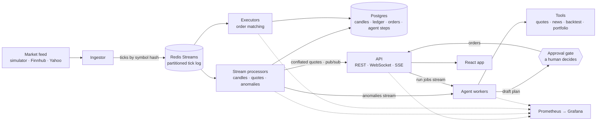

# BazaarPulse

> *Bazaar* (बाज़ार) is the market; *pulse* is its heartbeat.

BazaarPulse is a real-time market terminal with a paper-trading engine and an AI research desk. Prices stream in, become candles and alerts within milliseconds, and reach every open browser over WebSockets. You can trade with ₹10,00,000 of simulated money, and AI agents look things up with tools, analyse stocks in parallel, explain sudden moves on their own, and draft trades that only you can approve.

The money is fake. The engineering is not: an event-streaming pipeline with exactly-once effects, a double-entry ledger whose rules the database itself enforces, horizontally scalable workers with automatic failover, and an agent runtime where every step is audited.

```
docker compose up --build        # then open http://localhost:8080 and press "Enter the demo"
```

No API keys are needed. Without them the market is a seeded simulator and the agents run on a deterministic offline model, so the whole system works on a laptop and in CI. Add `ANTHROPIC_API_KEY` (Claude) or `GROQ_API_KEY` (Llama) for real models, and `MARKET_PROVIDER=finnhub` with `FINNHUB_API_KEY` for live US trades.

---

## What it does

| | |
|---|---|
| **Live market data** | Ticks are ingested from a feed (simulator, Finnhub WebSocket or Yahoo polling), written to a durable stream, aggregated into 1-minute candles, scanned for abnormal moves and pushed to browsers. |
| **Paper trading** | Market, limit and stop orders; pre-trade risk checks; fills against live prices with fees and slippage; positions, P&L and a full double-entry ledger. |
| **Copilot** | Ask anything. The agent calls tools (quotes, indicators, news search, backtests, your portfolio) and you watch each call and result as it happens. |
| **War room** | Three analyst agents (technical, news, risk) review one stock at the same time without seeing each other's work; a lead agent weighs their reports. |
| **Sentinel** | When the detector flags an unusual move, an agent investigates on its own and posts a short brief to everyone's live feed, within a hard spending cap. |
| **Human approval** | Agents can draft trade plans. They are risk-checked and wait for your click; no tool exists that lets an agent place an order. |
| **Operations view** | Live throughput, latency, stream backlog, ledger health and AI spend in the app, plus Prometheus metrics, alert rules and a Grafana dashboard. |

## Architecture



Every box is a separate process built from **one container image**, so each tier scales on its own: `docker compose up --scale processor=2 --scale agents=3`, or replica counts in the Helm chart.

### The decisions that matter

**Redis Streams as the event log.** Consumer groups give at-least-once delivery, acknowledgement, replay and takeover of a dead consumer's messages. One Redis also carries the quote cache, rate limits and pub/sub, so the system has two stateful dependencies instead of four. The bus interface is the subset Kafka offers too (publish, consume in a group, commit), so the transport can change without touching the workers.

**Exactly-once effects on an at-least-once stream.** The processor remembers, per symbol, the stream id of the last tick it applied, and saves that checkpoint in the *same Redis transaction* that acknowledges the batch. A redelivered tick is recognised and skipped; candles are upserted, so replaying one rewrites the identical row. Tested by delivering the same batch twice and by killing a processor mid-batch.

**Partition leases with fencing.** Ticks are split over partitions by a stable hash of the symbol, which keeps each symbol's ticks in order. Each partition is owned by one processor through a renewable Redis lease; owners share partitions fairly and a dead owner's partitions are taken over within the lease timeout. A processor that froze and lost its lease cannot overwrite its successor's state: the checkpoint transaction `WATCH`es the lease key and Redis aborts the write.

**The database enforces the money rules.** Every movement of value is a set of ledger entries that must sum to zero per asset. That is checked in code, then again at commit by a deferred constraint trigger, and a `CHECK` stops any customer balance going negative. Entries are append-only (a trigger rejects `UPDATE` and `DELETE`). Code that bypasses the ledger module still cannot corrupt the books; a test does exactly that and is refused.

**Concurrency without a global lock.** Placing an order takes a row lock on the user's own cash account, which serialises that user's orders and nobody else's, so two concurrent orders cannot both spend the same cash. Executors claim orders with `FOR UPDATE SKIP LOCKED`, so several can run and each order fills exactly once. Ledger rows are always locked in sorted order, so opposite transfers cannot deadlock. The shared market and fee accounts are deliberately not locked or cached: every trade touches them, and locking them would make every trade in the system queue behind one row.

**Transactional outbox.** Order and fill events are written in the same transaction as the change they describe, then published after commit. An event is never sent for a change that rolled back, and never lost for one that committed.

**Agents are durable jobs.** The API writes a `queued` run and returns at once; a worker picks the job up from a stream. Every model turn, tool call and result is stored in Postgres and published to a per-run stream that browsers follow with Server-Sent Events, resuming from `Last-Event-ID` after a disconnect. Runs outlive browser tabs, and agent capacity scales separately from the API.

**Safety by construction, not by prompt.** The model never sees a user id: identity is injected by the server, so it cannot ask for someone else's data. Tool inputs are validated against closed schemas. News text is labelled as third-party data. There is no order-placing tool at all; approval is an authenticated HTTP call that only a person makes. The autonomous sentinel has a per-symbol cooldown and an hourly cap it cannot talk its way past.

**One model gateway.** All model calls go through one place that enforces a daily token budget per user, fails over between real providers, records tokens and cost, and never silently falls back to the offline model (a fake answer that looks real is worse than an error). The Claude adapter uses the official SDK with strict tool schemas, prompt caching on the byte-stable system prompt, and server-side refusal fallback.

**Backpressure at the edge.** Quotes are conflated twice: the processor sends at most one update per symbol per 250 ms, and each WebSocket client keeps only the newest pending quote per symbol. A slow phone skips intermediate prices instead of growing a queue until the server runs out of memory; a client that stops reading entirely is disconnected after five seconds.

## Results

Measured, not estimated. Commands to reproduce are in each row.

| What | Result |
|---|---|
| Backend tests (`uv run pytest`) | **102 passing** against real Postgres and Redis, including concurrency, crash-recovery and property-based tests |
| Frontend tests (`npx vitest run`) | 8 passing |
| Pipeline latency, tick to fan-out (System page) | p50 **3–4 ms**, p95 **5–9 ms** at ~30 ticks/s |
| Load test, 30 s, 4-vCPU VM, generator on the same machine (`scripts/loadtest.py --sockets 300 --traders 40`) | 300/300 WebSockets connected, **~7,000 quotes/s delivered**, 0 errors; ledger balanced after ~1,800 trades |
| Same test, place-order latency | 1 API process: p50 411 ms, p95 2.2 s. **3 API processes: p50 166 ms, p95 1.5 s** |
| Failover (`docker compose up --scale processor=2`, then `docker kill` one) | Survivor took the dead replica's partition within the lease timeout; backlog stayed at 0 |

The latency numbers are from a small shared VM where the load generator competed for the same four cores; read them as a comparison between configurations, not as a capacity claim. Rejections in that run were the per-user order-rate limit and sells without holdings, both working as intended.

## Running it

**Everything in containers** (needs Docker):

```bash
docker compose up --build
# app        http://localhost:8080
# API docs   http://localhost:8000/docs
# Grafana    http://localhost:3000   (admin / admin)
# Prometheus http://localhost:9090
```

**For development** (Python 3.12+, [uv](https://docs.astral.sh/uv/), Node 22, a local Postgres 16 and Redis 7):

```bash
cd backend
uv sync
uv run bazaarpulse migrate
uv run bazaarpulse api --reload        # API plus every worker in one process (EMBEDDED_WORKERS=all)

cd ../frontend
npm install
npm run dev                            # http://localhost:5173, proxies /api and /ws to :8000
```

**Tests**

```bash
cd backend && uv run pytest            # expects Postgres (bazaarpulse_test) and Redis on localhost
cd frontend && npx vitest run
python3 scripts/smoke_test.py http://localhost:8080
```

**Kubernetes**: `deploy/helm/bazaarpulse` deploys the API, the four workers and the web tier, with a pre-upgrade migration job, readiness and liveness probes, a disruption budget, autoscaling for the API and agents, and an ingress for HTTP, SSE and WebSockets. Postgres and Redis are expected to be managed services; their URLs and the API keys come from a Secret you provide.

## Configuration

All settings are environment variables (see `backend/src/bazaarpulse/config.py`). The ones you are most likely to set:

| Variable | Default | Purpose |
|---|---|---|
| `MARKET_PROVIDER` | `simulator` | `simulator`, `finnhub` (live US trades, needs `FINNHUB_API_KEY`) or `yahoo` (NSE quotes by polling an unofficial endpoint; personal use only) |
| `LLM_PROVIDER` | `auto` | `auto` picks Claude if `ANTHROPIC_API_KEY` is set, else Groq if `GROQ_API_KEY` is set, else the offline model |
| `ANTHROPIC_MODEL` | `claude-opus-5-5` | Model used for agents when Claude is the provider |
| `TICK_PARTITIONS` | `1` | How many stream partitions ticks are split over; the ceiling for processor replicas |
| `JWT_SECRET` | dev value | Must be set when `ENV=prod`; the app refuses to start with the development value |

## CI/CD

Every push runs: backend lint, type check and tests against real Postgres and Redis; frontend lint, type check, tests and build; Helm lint and Kubernetes schema validation; both images built, scanned for fixable critical vulnerabilities, and started together for an end-to-end smoke test (sign in, prices moving, order filled, agent answered, books balanced). On `main`, the images are pushed to GHCR tagged with the commit.

## Project layout

```
backend/src/bazaarpulse/
  marketdata/   providers (simulator, Finnhub, Yahoo) · ingestor · stream processor · candles · indicators · anomaly detector · store
  trading/      money · ledger · risk engine · order service · executor · portfolio
  agents/       LLM gateway and providers · tools · runtime · copilot / war room / sentinel · proposals · backtester · prompts
  bus/          Redis Streams bus · topics · partition leases
  api/          FastAPI app · routes · WebSocket hub · auth
  db/           models · seed          (schema: backend/alembic/versions)
frontend/src/   views (Terminal, AI Desk, System) · components · lib (API, WebSocket, SSE)
deploy/helm/    Kubernetes chart
infra/          Prometheus config and alerts · Grafana dashboard
scripts/        smoke test · load test
docs/           architecture notes · interview preparation
```

## Limitations

- **Simulated by default.** Offline, prices come from a statistical simulator and the agents from a scripted model that is clearly labelled in every answer. They exist so the system can be developed, tested and demonstrated without keys; they say nothing about markets or about model quality.
- **Fills are simplified.** Orders fill in full at the market price plus fixed slippage. There is no order book, partial fill or market impact.
- **Single-region, single Redis.** Redis is a single point of failure for the live path (Postgres keeps the durable record). Production would use a replicated Redis or move the tick log to Kafka.
- **The anomaly detector is a z-score on short returns.** It finds sharp moves; it does not know about scheduled events, and its thresholds were set by eye on simulated data.
- **Not investment advice.** It is a learning project. Nothing here should be used to make real trading decisions.

## Roadmap

- Partial fills and a simulated order book with queue position.
- Kafka (or Redpanda) as the tick log, with the same bus interface.
- Postgres read replica for chart queries; TimescaleDB continuous aggregates for wide intervals.
- Evaluation set for the agents (grounding, tool-use accuracy, refusal behaviour) run in CI against a real model.
- OpenTelemetry traces that follow a tick from the feed to the browser.

## License

MIT
